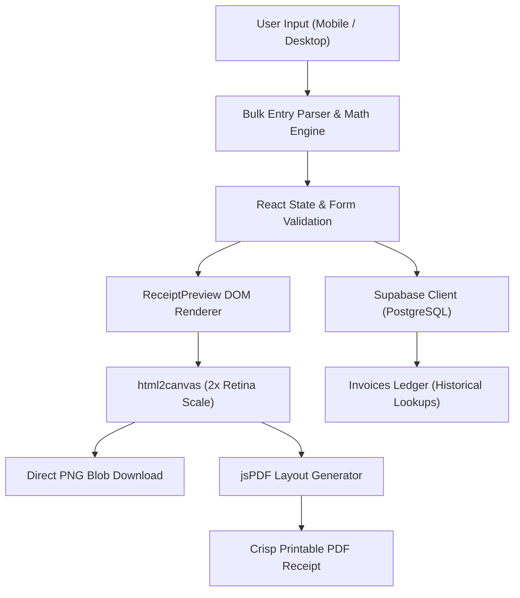

# 🧾 Sales Receipt Generator | Mobile-First Billing Engine & Invoice Ledger

[](https://react.dev/)
[](https://www.typescriptlang.org/)
[](https://tailwindcss.com/)
[](https://supabase.com/)
[](https://vitejs.dev/)
[](https://vercel.com/)

> **Sales Receipt Generator** is a mobile-first, single-page client billing application tailored for small-to-medium retail enterprises. It streamlines counter transactions with a high-speed bulk item entry interface, automated multi-tier financial calculations (discounts, delivery fees, advance deposits, balance due), and instant client-side PNG/PDF invoice generation backed by Supabase PostgreSQL.

---

## 🏗️ System Architecture & Workflow



---

## ⚡ Key Engineering Highlights

### 1. 🧮 High-Speed Bulk Entry & Financial Calculation Engine
* **Rapid Multi-Line Input:** Custom text parser supporting quick bulk entry of items, quantities, and unit prices, eliminating tedious line-by-line manual form submissions.
* **Dynamic Real-Time Rebalancing:** Computes subtotals, multi-type discounts (percentage vs. fixed value), regional delivery/shipping fees, advance payments, and remaining balance due instantaneously with zero UI stutter.

### 2. 🖨️ Pixel-Perfect Client-Side PNG & PDF Export
* **Retina Canvas Rasterization:** Leverages `html2canvas` at high-DPI resolution (`scale: 2`) with CORS image handling and strict background color normalization, producing crisp printable graphics.
* **Vectorized jsPDF Delivery:** Converts rendered DOM blueprints into standardized, computer-generated invoice documents with zero server-side rendering latency or compute costs.

### 3. 🗄️ Supabase PostgreSQL Historical Ledger
* **Sequential Invoice Sequencing:** Automated serial numbering using PostgreSQL sequence generators for deterministic auditing.
* **Structured Payload Persistence:** Stores rich client metadata, line-item arrays (`JSONB`), and timestamped settlement details for instant retrieval and reprinting.

### 4. 🏢 Configurable White-Label Business Theming
* Fully decoupled business credentials: store names, branches, and banking account numbers are injected via environment configurations, keeping core logic completely generic and privacy-compliant.

---

## 📂 Project Structure

```text
bill-receipt-generator/
├── public/                    # Static brand assets & icons
├── src/
│   ├── components/            # UI Components
│   │   ├── InvoiceHistory.tsx # Past invoice list, search, and reprint viewer
│   │   ├── Navigation.tsx     # Tabbed switching (Generator / History)
│   │   ├── ReceiptPreview.tsx # Printable receipt layout & html2canvas/jsPDF exporter
│   │   └── SalesReceipt.tsx   # Core billing form, bulk product importer, state math
│   ├── types/                 # TypeScript interfaces (Invoice, Item, Customer, Config)
│   ├── utils/                 # Currency formatters & Supabase API wrappers
│   ├── App.tsx                # App root & navigation orchestrator
│   └── main.tsx               # DOM bootstrap
├── supabase/
│   └── migrations/            # PostgreSQL DDL migrations & RLS policies
├── .env.example               # Template environment configuration
└── vite.config.ts             # Vite bundler configuration & plugins
```

---

## 🚀 Getting Started

### Prerequisites
* [Node.js](https://nodejs.org/) (v18+ recommended)
* `npm` or `pnpm`

### 1. Clone & Install Dependencies
```bash
git clone https://github.com/lithafawfadh/Sales-Receipt-Generator.git
cd Sales-Receipt-Generator
npm install
```

### 2. Configure Environment Variables
Create a `.env` file in the root directory:
```bash
cp .env.example .env
```
Populate with your Supabase credentials:
```env
VITE_SUPABASE_URL=https://your-project.supabase.co
VITE_SUPABASE_ANON_KEY=your-supabase-anon-key

# Optional White-Label Customization
VITE_BUSINESS_NAME=MY STORE
VITE_BRANCH_NAME=(Main Branch)
VITE_BANK_1_NAME=BOC BANK
VITE_BANK_1_ACCOUNT=12345678
```

### 3. Run Development Server
```bash
npm run dev
```
Open `http://localhost:5173` in your browser.

---

## 👨‍💻 Author & Credits

* **Developer:** **Mohamed Lithaf Awfadh** ([@lithafawfadh](https://github.com/lithafawfadh))
* **Education:** B.Sc. (Hons) in Information Technology (Software Engineering) @ SLIIT | Dean's List Awardee
* **Project Type:** Client Software Commission (Freelance Production Engineering)

---

## 📄 License
This project is open-source under the [MIT License](LICENSE).
